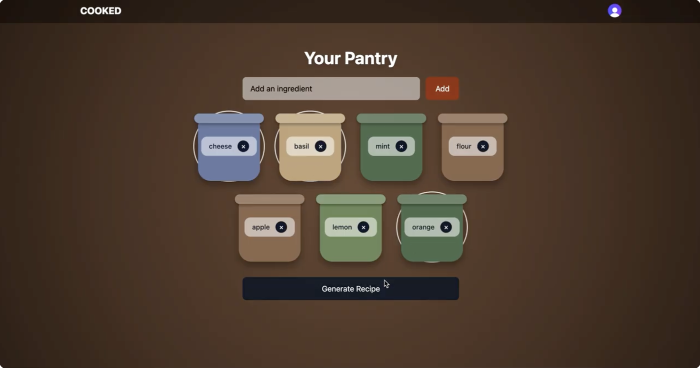
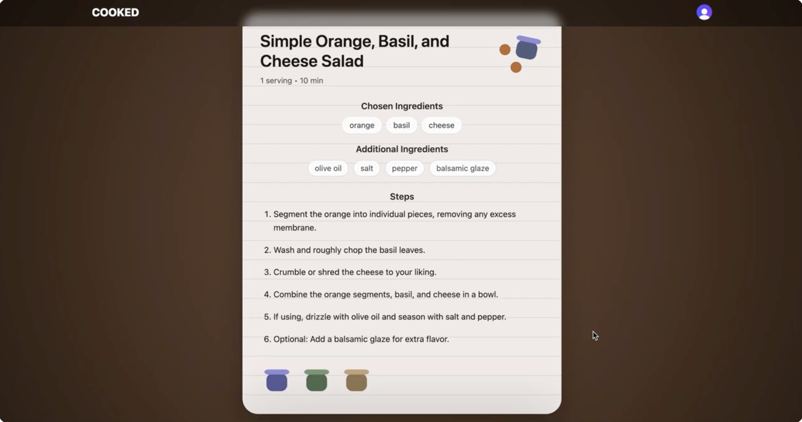
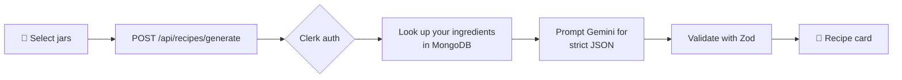

<p align="center">
  
</p>

<p align="center">
  
  
  
  
  
  
</p>

<p align="center">
  <b>Open the fridge. Stare blankly. Close the fridge.</b><br/>
  COOKED fixes that. Drop your ingredients into jars, pick a few, and get a real recipe back.
</p>

<p align="center">
  <a href="https://youtu.be/KaF2EvX65L8"><b>▶ Watch the demo</b></a>
</p>

---

## 🫙 What it does

| | |
|---|---|
| 🔐 **Sign in your way** | Email or Google sign in through Clerk, plus profile name and photo editing |
| 🫙 **A pantry that remembers** | Every ingredient becomes its own colored jar, saved to your account so it is still there next time |
| 👆 **Pick what to cook with** | Tap jars to select them, tap the ✕ to toss them |
| 🍳 **Recipes on demand** | Gemini turns your picks into one practical recipe, shown as a cookbook-style card |
| 🧂 **Honest extras** | Anything you don't have (oil, salt, a glaze) is listed separately, capped at 5 items |
| 🎈 **Little details** | A landing page with bouncing jars, because why not |

## 📸 Screenshots

<table>
  <tr>
    <td align="center"><b>Your Pantry</b></td>
    <td align="center"><b>Generated Recipe</b></td>
  </tr>
  <tr>
    <td><a href="https://youtu.be/KaF2EvX65L8"></a></td>
    <td><a href="https://youtu.be/KaF2EvX65L8"></a></td>
  </tr>
</table>

## 🧑‍🍳 How a recipe gets made



Gemini is asked for one practical recipe with 4 to 8 short steps, returned as JSON:

```json
{
  "title": "Simple Orange, Basil, and Cheese Salad",
  "servings": 1,
  "timeMinutes": 10,
  "ingredientsUsed": ["orange", "basil", "cheese"],
  "additionalIngredients": ["olive oil", "salt", "pepper", "balsamic glaze"],
  "steps": ["Segment the orange...", "Wash and roughly chop the basil..."]
}
```

The backend pulls the JSON out of the response and checks it against a Zod schema before it ever reaches the UI, so a messy model reply never breaks the page.

## 🧰 Tech stack

| Layer | Tools |
|---|---|
| Frontend | React 19, Vite, Tailwind CSS, React Router |
| Backend | Node.js, Express 5, Zod validation |
| Database | MongoDB Atlas with Mongoose (ingredients are unique per user, case-insensitive) |
| Auth | Clerk, with every API route protected by `requireAuth()` |
| AI | Google Gemini (`gemini-1.5-flash`) |

## 🗂️ Project structure

```
cooked-recipe-generator/
├── frontend/
│   └── src/
│       ├── pages/          Landing.jsx, Pantry.jsx
│       └── components/     JarCard.jsx, RecipeCard.jsx, Navbar.jsx
└── backend/
    └── src/
        ├── index.js        Express app, Clerk middleware, Mongo connection
        ├── gemini.js       Gemini client
        ├── models/         Ingredient.js
        └── routes/         ingredients.js, recipes.js
```

## 🔌 API

All routes need a signed-in Clerk session.

| Method | Route | What it does |
|---|---|---|
| `GET` | `/api/ingredients` | List your pantry |
| `POST` | `/api/ingredients` | Add an ingredient |
| `DELETE` | `/api/ingredients/:id` | Remove an ingredient |
| `POST` | `/api/recipes/generate` | Send `{ ingredientIds: [...] }`, get a recipe back |

## 🚀 Run it locally

**1. Clone and install**

```bash
git clone https://github.com/naishuvytla/Cooked-Recipe-Generator.git
cd Cooked-Recipe-Generator

cd backend && npm install
cd ../frontend && npm install
```

**2. Add your keys**

`backend/.env`

```env
PORT=5000
MONGODB_URI=your_mongodb_atlas_uri
CLERK_PUBLISHABLE_KEY=pk_test_...
CLERK_SECRET_KEY=sk_test_...
GEMINI_API_KEY=your_gemini_api_key
```

`frontend/.env`

```env
VITE_CLERK_PUBLISHABLE_KEY=pk_test_...
VITE_API_BASE_URL=http://localhost:5000
```

**3. Start both servers** (two terminals)

```bash
# terminal 1
cd backend && npm run dev

# terminal 2
cd frontend && npm run dev
```

**4. Open** [http://localhost:5173](http://localhost:5173) and start filling jars 🫙

## 🌱 Ideas for later

- Save favorite recipes to a cookbook
- Dietary filters (vegetarian, gluten free)
- Suggest which pantry items to use up first

---

<p align="center">Made with 🧄 and a nearly empty fridge by <a href="https://github.com/naishuvytla">Naishu Vytla</a></p>
